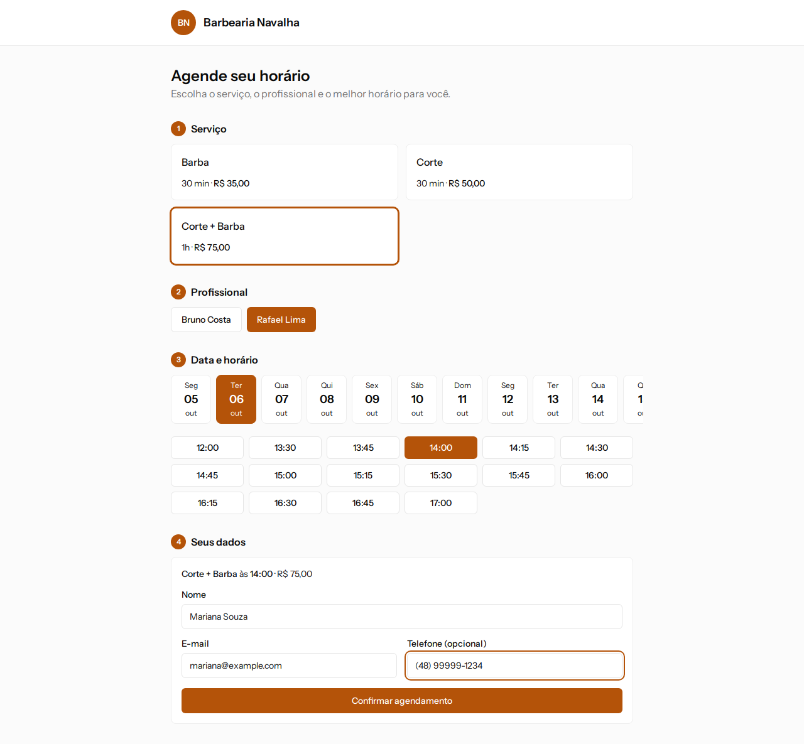
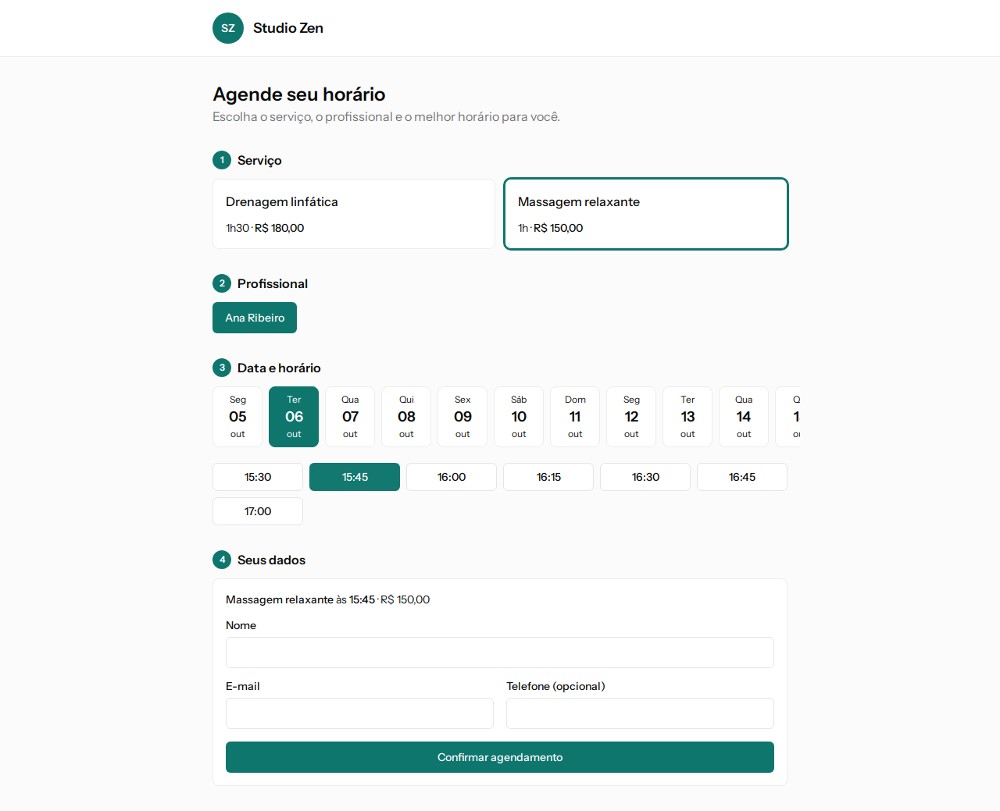
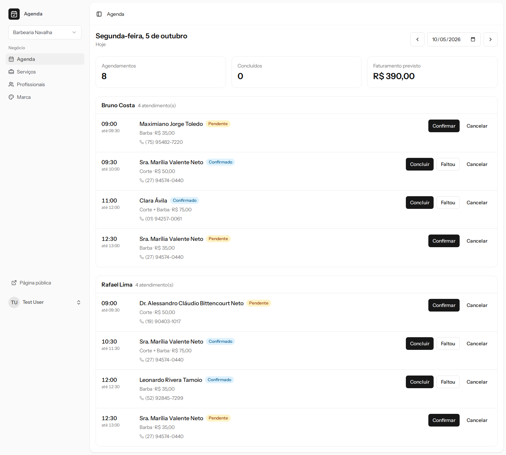
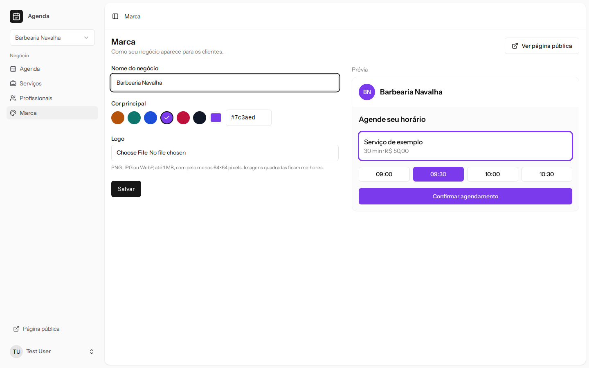
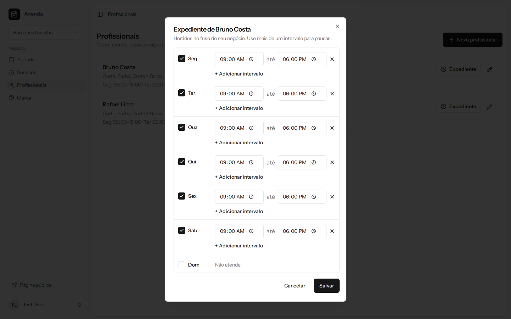
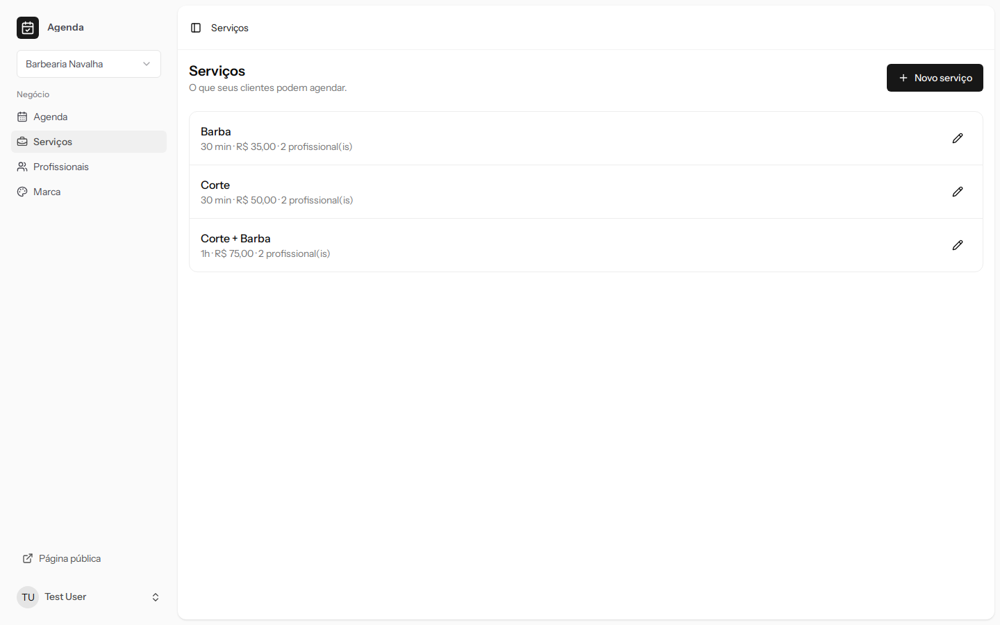
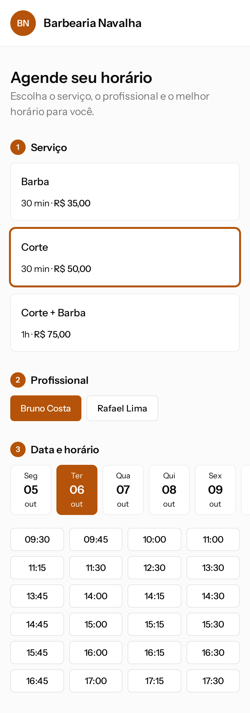
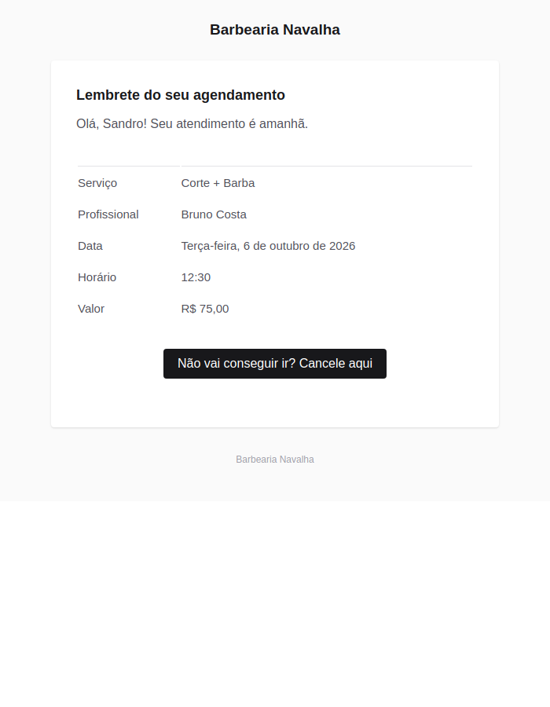

# Agenda — agendamento online whitelabel

[](https://github.com/Vitor-assis20/agenda-whitelabel/actions/workflows/tests.yml)
[](https://github.com/Vitor-assis20/agenda-whitelabel/actions/workflows/lint.yml)

SaaS multi-tenant de agendamento para negócios de serviço — barbearias, clínicas, estúdios. Cada negócio tem sua própria página pública, no seu subdomínio e com sua marca, onde os clientes reservam horários; e um painel para gerenciar agenda, serviços, profissionais e aparência.

**Stack:** Laravel 12 · PHP 8.4 · React 19 · TypeScript · Inertia.js · Tailwind CSS 4 · PostgreSQL 17 · Redis · Docker

| Página pública da Barbearia | Mesma aplicação, outra marca |
| --- | --- |
|  |  |

| Agenda do dia no painel | Configuração da marca, com prévia |
| --- | --- |
|  |  |

<details>
<summary>Mais telas</summary>

| Expediente semanal | Serviços | Mobile | Lembrete por e-mail |
| --- | --- | --- | --- |
|  |  |  |  |

</details>

## Funcionalidades

**Página pública** (`{negocio}.seudominio.com`)
- Fluxo serviço → profissional → data e horário → dados, com horários livres calculados em tempo real
- Marca do negócio (cor, logo, nome) aplicada em toda a página, inclusive no título da aba
- Confirmação por link assinado; cliente recorrente reconhecido pelo e-mail
- O cliente cancela pelo próprio link enquanto o atendimento não começou

**E-mails ao cliente** (com a marca do negócio, enviados por fila)
- Confirmação da reserva, lembretes 24h e 2h antes, aviso de cancelamento

**Painel** (dono, administradores e equipe)
- Agenda do dia por profissional, com resumo e faturamento previsto
- Ciclo de vida do agendamento: confirmar, concluir, marcar falta, cancelar
- Cadastro de serviços, profissionais e expediente semanal (com pausas)
- Folgas e bloqueios (dia inteiro ou parte do dia), com aviso dos agendamentos já marcados no período
- Marca do negócio com prévia ao vivo da página pública
- Papéis: dono e administradores gerenciam tudo; a equipe vê e altera só a própria agenda
- Um usuário pode participar de vários negócios e alternar entre eles

## Decisões técnicas

### Nenhum horário reservado duas vezes — garantido pelo banco
A checagem de disponibilidade na aplicação não basta: duas requisições simultâneas podem passar por ela ao mesmo tempo. A garantia final é uma *exclusion constraint* do PostgreSQL:

```sql
EXCLUDE USING gist (
    professional_id WITH =,
    tstzrange(starts_at, ends_at, '[)') WITH &&
) WHERE (status IN ('pending', 'confirmed'))
```

Intervalos semiabertos permitem horários colados (10h–11h e 11h–12h), e cancelamentos liberam o horário. Uma segunda constraint igual, por `customer_id`, impede que o mesmo cliente ocupe dois horários sobrepostos com profissionais diferentes; o nome da constraint violada diz qual mensagem mostrar. A migration que a cria verifica os dados antes e, se houver conflitos, para e lista os agendamentos a resolver, em vez de cancelar algo por conta própria. A violação (`SQLSTATE 23P01`) vira uma mensagem amigável — *"Este horário acabou de ser ocupado"* — e há um teste que simula exatamente essa corrida ([`BookAppointment`](app/Scheduling/BookAppointment.php)).

### Multi-tenancy com isolamento em duas camadas
Banco único, `tenant_id` em todas as tabelas.

- **Aplicação:** um *global scope* filtra toda consulta pelo tenant atual e **falha fechado** — sem tenant definido, a consulta não retorna nada, em vez de retornar dados de todos ([`TenantScope`](app/Support/Tenancy/TenantScope.php)).
- **Banco:** chaves estrangeiras compostas `(tenant_id, id)` tornam impossível, por exemplo, um agendamento de um negócio apontar para o profissional de outro — mesmo que o código tenha um bug.

O tenant vem do subdomínio (página pública) ou da sessão (painel), resolvido por middlewares que rodam **antes** do *route model binding*, para que `/agendamentos/{id}` de outro negócio resulte em 404.

### Fuso horário
Tudo é gravado em UTC (`timestamptz`) e exibido no fuso de cada negócio. No caminho apareceu uma armadilha: o Eloquent grava datas **sem o offset**, então um horário de São Paulo seria salvo como se fosse UTC — 3 horas de diferença. Um cast próprio ([`UtcDateTime`](app/Casts/UtcDateTime.php)) converte antes de gravar, e a sessão do Postgres é fixada em UTC. Um teste confere o valor gravado no banco.

### Filas, lembretes e o tenant que não existe no worker
Os e-mails saem por fila (Redis) e os lembretes por um comando agendado a cada 5 minutos.

- **Notificações carregam dados prontos, nunca models.** O worker da fila não tem tenant no contexto; um model serializado seria recarregado pelo *global scope*, que falha fechado e não encontraria nada. A notificação leva um [`AppointmentSummary`](app/Scheduling/AppointmentSummary.php) só com textos e números — e um teste garante que nenhum model vai para a fila.
- **Lembrete nunca enviado duas vezes.** Antes de enviar, o comando registra o envio numa tabela com `UNIQUE (appointment_id, kind)`; se dois agendadores rodarem juntos, só um consegue inserir ([`SendAppointmentReminders`](app/Console/Commands/SendAppointmentReminders.php)).
- **Lembrete que faz sentido.** Só vale se o agendamento já existia quando chegou a hora dele (quem reserva em cima da hora recebe só a confirmação), e o de 24h é descartado quando o de 2h já está no prazo — um agendador que volta de uma pausa não manda "é amanhã" a uma hora do atendimento.
- **E-mail só depois do commit:** se a reserva falha, nenhum e-mail sai.

### Whitelabel de verdade
- A cor do negócio sobrescreve as variáveis de tema do Tailwind, e todos os componentes herdam a marca.
- O texto sobre a cor (preto ou branco) é escolhido pelo **contraste WCAG**, então qualquer cor escolhida pelo dono continua legível.
- O nome da plataforma não aparece nas páginas do cliente — nem na aba do navegador, nem nos e-mails (remetente, cabeçalho, rodapé e `<title>`).
- Logos SVG são recusados (podem conter scripts e seriam servidos pelo mesmo domínio); o banco guarda o caminho do arquivo, não a URL.

### Disponibilidade
Horários livres = **expediente − folgas − agendamentos ativos**, oferecidos a cada 15 minutos. A agenda do dia é carregada em três consultas e os horários são calculados em memória ([`Availability`](app/Scheduling/Availability.php)).

## Qualidade

- **158 testes** (feature e integração), rodando em **PostgreSQL real** — as regras mais importantes vivem no banco e precisam ser testadas lá
- CI no GitHub Actions: testes com Postgres, Pint, Prettier, ESLint e `tsc` a cada push
- Regras de negócio fora dos controllers: [`app/Scheduling`](app/Scheduling) concentra disponibilidade, reserva e mudanças de status

```
app/
├── Scheduling/          Disponibilidade, reserva, transições de status
├── Support/Tenancy/     Tenant atual, global scope
├── Http/Middleware/     Resolução do tenant (subdomínio e painel)
├── Http/Controllers/    Booking/ (público) e Panel/ (painel)
├── Policies/            Quem pode alterar cada agendamento
└── Casts/UtcDateTime    Datas sempre em UTC
resources/js/
├── pages/booking/       Página pública
├── pages/panel/         Painel
└── components/tenant-brand.tsx   Tema da marca + contraste
```

## Rodando localmente

Requisitos: Docker e Docker Compose.

```bash
git clone https://github.com/Vitor-assis20/agenda-whitelabel.git
cd agenda-whitelabel
cp .env.example .env

docker compose up -d --build
docker compose exec app composer install
docker compose exec app npm ci
docker compose exec app php artisan key:generate
docker compose exec app php artisan migrate --seed
docker compose exec app php artisan storage:link
docker compose exec app npm run build    # ou "npm run dev" para hot reload
docker compose restart queue scheduler   # worker e agendador, agora com as dependências instaladas
```

O `queue` processa os e-mails e o `scheduler` dispara os lembretes a cada 5 minutos. Para enviar os lembretes na hora: `docker compose exec app php artisan appointments:send-reminders`.

| Endereço | O que é |
| --- | --- |
| http://localhost:8000 | Site e painel (login abaixo) |
| http://barbearia-navalha.localhost:8000 | Página pública de um negócio |
| http://studio-zen.localhost:8000 | Página pública de outro negócio |
| http://localhost:8025 | Mailpit: todos os e-mails enviados (confirmações, lembretes) |

`*.localhost` aponta para a própria máquina nos navegadores modernos, sem editar o arquivo `hosts`.

**Usuários de demonstração** (senha `password`):
- `test@example.com` — dono dos dois negócios
- `rafael@example.com` — membro da equipe da Barbearia (vê só a própria agenda)

**Testes:**

```bash
docker compose exec app php artisan test
```

## Próximos passos

- Lembretes por WhatsApp
- Remarcação pelo próprio cliente
- Botões do e-mail na cor da marca
- Cadastro self-service de novos negócios
- Aviso de agendamentos afetados ao reduzir o expediente

## Licença

MIT
